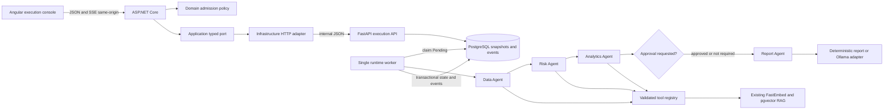
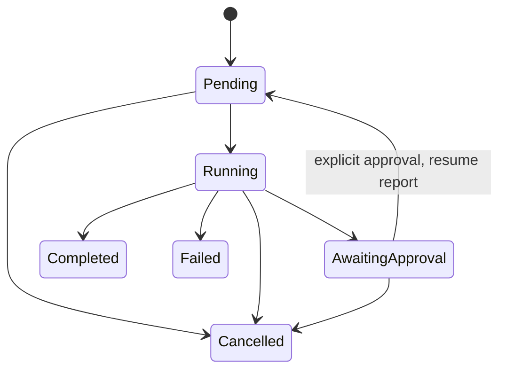

# Agent orchestrator — Stage 2

The runtime coordinates a fixed, verifiable workflow; an LLM cannot choose arbitrary tools or grant permissions. See [ADR 0003](../adr/0003-agent-orchestration.md) for the audited decision and rejected alternatives.

## Responsibilities and contracts

| Agent | Input | Verified responsibility | Output |
|---|---|---|---|
| Data | Admitted workflow, fixture ID, task, metadata filter | Reads fictional portfolio where applicable and retrieves RAG evidence | Typed portfolio/document data with actual reference IDs |
| Risk | Validated Data result | Concentration weight and HHI for fixtures; evidence coverage limitations for documents | Risk indicators and explicit limitations |
| Analytics | Validated Data result, after Risk completion | Total value, asset count and illustrative weighted return; or retrieval counts/average score | Numeric metrics, no fabricated prices |
| Report | Completed prior results | Consolidates structured analysis; optionally asks configured Ollama for prose | Summary, provider label, evidence status and full analysis |

Dependencies are admitted as two fixed plans, `portfolio-review` and `document-review`, both using the four agents in the above order. Planning is not described as autonomous LLM reasoning. Portfolio values are built-in fictional inputs; illustrative returns are not investment advice or forecasts. Lack of documentary evidence remains visible even when fixture arithmetic is possible.

The provider boundary is `generate(provider, task, results)` in `executions/providers.py`, separate from the coordinator and tool dispatcher. It supports explicitly labeled deterministic summaries and the documented Ollama HTTP adapter. There is no silent fallback. Only the report provider may generate prose; retrieved citations remain structured tool/database references. LLM prose is untrusted and requires review.

## Safe tools

`portfolio.read`, `knowledge.search`, `risk.calculate`, and `metrics.calculate` have descriptions, Pydantic-generated JSON input schemas, explicit allowed-agent sets and validated output-producing handlers. Calculation inputs use discriminated portfolio/document schemas. `catalog()` exports descriptions/schemas for a future tool integration; no MCP transport exists. Dispatch rejects unknown tools, malformed arguments and agents without permission. Users cannot submit role/tool permissions or executable code.

Every tool start/completion/failure is persisted, with arguments, result/error and duration. Report-provider events are separate `ProviderStarted`, `ProviderCompleted`, `ProviderFailed`; they do not pretend to be registry tool calls.

## Durability and lifecycle

V003 creates `knowledge.agent_executions` (snapshot/request/state) and `knowledge.agent_execution_events` (per-execution sequence/event). State changes and events share row-locked transactions. A queue index supports claim order; `FOR UPDATE SKIP LOCKED` claims Pending rows. Migration scripts remain checksummed and V001/V002 are unchanged.

The worker holds a PostgreSQL session advisory lock, so a second live worker cannot recover/fail the owner's active runs. On lock acquisition after restart, interrupted Running runs become Failed; Pending and AwaitingApproval survive. No exactly-once claim is made across arbitrary distributed/network partitions. The supported deployment is one local runtime worker.

Approval persists a flag and requeues the existing run; completed agents are skipped on resume. Cancellation marks the snapshot terminal under a row lock. Subsequent tool completions cannot overwrite Cancelled because updates require Running. Since tools are read-only, an already-running call may finish internally but cannot publish a completed execution after cancellation. Agent states include Skipped for remaining work after failure.

Each operation is bounded to a 45-second wait; Ollama uses a 30-second network timeout and bounded output. Python cannot forcibly kill native embedding work: one outstanding operation slot prevents unbounded background threads, and subsequent work fails visibly until the slot is released. This is not process isolation.

## HTTP, SSE and frontend

Public requests enter .NET; Domain validates workflow/task/fixture admission, Application defines typed snapshots/events, Infrastructure maps runtime errors to sanitized HTTP status. JSON upstream calls are bounded to 15 seconds/8 MB; RAG keeps its existing settings. The runtime independently validates input and tool permissions.

The .NET SSE route polls persisted events, emits IDs and `event: execution`, replays after Last-Event-ID, sends heartbeats and closes after draining terminal events. Disconnecting a stream does not cancel the durable execution. Angular refreshes authoritative snapshots, coalesces events arriving during refresh, guards stale requests after selection changes, and falls back to bounded polling when SSE fails.

The UI preserves the Stage1 knowledge screen. It exposes history, explicit approval/cancellation, agent durations/results and tool/evidence events. It identifies deterministic output as **not LLM inference**.

## Security and validation boundary

This remains localhost single-user without authentication/RBAC. Server-side tool capability checks are not user authorization. Events contain requests and excerpts, so production needs identity, access controls, retention, quotas and PDF/process isolation. Readiness checks all three migrations/tables but does not prove external Ollama availability or continuous worker liveness.

See [validation](../validation/stage-2-orchestrator.md) for actual checks and [PowerShell demo](../demo-orchestrator.md). Real model inference is externally configured and must be reported separately from deterministic orchestration and adapter unit tests.
