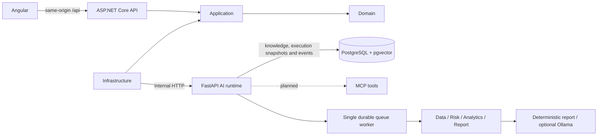

# AEGIS AGENT LAB architecture

Independent portfolio project using fictional data. It does not reproduce any institution's internal architecture.

## Bootstrap scope

Deliver three runnable service entry points, health probes, Clean Architecture references, an explicit runtime contract, PostgreSQL with pgvector, and a reproducible development topology. Stage1 added retrieval (ADR 0002); Stage2 added durable agent execution (ADR 0003). Authentication, MCP transport and telemetry export remain future work. See [orchestrator architecture](agent-orchestrator.md) for the implemented agent plan, tools, lifecycle and event transport.

## Boundaries

- Domain: public workflow admission and valid execution/agent states; no framework dependencies.
- Application: typed use-case contracts and ports; depends only on Domain.
- Infrastructure: runtime HTTP adapter; depends on Application. Requests have bounded timeouts.
- API: composition root, HTTP routing, validation and JSON logging. Browser traffic never reaches Python directly.
- Runtime: real FastEmbed embeddings, extraction, retrieval, durable orchestration, validated internal tools and report provider. Health reports the configured provider; default deterministic concerns reporting, not embeddings. No bank credentials or real financial operations.
- Database: knowledge.documents and knowledge.document_chunks, vector(384), HNSW cosine index and checksummed versioned migrations. Implemented code and actual database verification are reported separately in the engineering log.

## Security and reliability design

Future JWT validation and tenant identity are enforced by the API. Python must not trust caller-supplied roles. Persist executions and audit events before adding asynchronous delivery. Implement idempotency and ownership checks before exposing execution endpoints. Tool permissions and human approval are enforced outside LLM output. Never log prompts, credentials or financial payloads by default.

Liveness is `/health`; API readiness `/health/ready` probes runtime readiness. Native startup applies migrations and warms embeddings. Runtime readiness checks knowledge/execution tables and three migration ledger entries; it does not prove configured Ollama availability. Logs are JSON (third-party model diagnostics may use their own output). OpenTelemetry exporters remain unimplemented. Stage2 uses persisted events plus SSE rather than a message broker.

## Delivery order (48-hour timebox)

1. Foundation and contracts (this increment).
2. Persisted execution lifecycle, deterministic four-agent flow, SSE and audit.
3. JWT/RBAC, ownership isolation, tool policy and approval checks.
4. MCP tool transport, document retrieval with citations and bounded context.
5. Execution dashboard, failure tests, OpenTelemetry export and demo walkthrough.

RabbitMQ is deferred until durable dispatch and idempotent consumers justify its operational cost.
